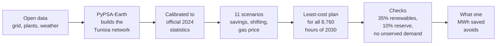

# What is one saved MWh worth to Tunisia?

### Energy efficiency and demand flexibility in Tunisia's 2030 power system, modelled hour by hour with PyPSA-Earth

[](LICENSE) [](LICENSE-docs.md)  

*By Rayen Romdhani, energy engineering student at ENIM (Monastir, Tunisia).*

---

In 2024, **94.5%** of Tunisia's electricity came from burning natural gas, and about three quarters of the country's gas came from Algeria. The country has promised **35% renewable electricity by 2030**, while demand keeps growing by about 3% a year.

Everyone talks about building more solar. I wanted to know what happens on the other side of the meter:

> **If Tunisia uses one MWh less in 2030, what does its power system no longer have to buy, burn or build?**

So I built a model of the whole Tunisian power system, ran 2030 eleven different ways, and measured the difference.


## Four things the model found

**1. A 10% saving cancels a gas plant.** To keep a safe margin above the 2030 peak, the base case needs **423 MW of new gas turbines**. Save 10% in every hour and the model builds none of them.

**2. When you save matters as much as how much.** Take the same 15% of energy out of summer air conditioning first, and each saved MWh avoids **20% more gas and CO2**. Air-conditioning hours are exactly when the gas plants run.

**3. Moving demand by three hours is worth real money.** Let 300 MW of demand shift a few hours into the midday sun, and the system saves another **22 M EUR a year** and **0.24 Mt of CO2**, on top of the 15% saving.

**4. The gas price decides what a saved MWh replaces.** With cheap gas, a saved MWh mostly displaces gas (**0.28 t of CO2** avoided). With expensive gas, the system is already 70% renewable, so it mostly displaces solar, wind and batteries (**0.11 t**, but more money).

And a plot twist: with 2030 cost projections, the cheapest 2030 system reaches **56% renewables** without being forced to. The 35% target only bites if gas gets cheap. (Big caveat: the model has no limit on how fast Tunisia can actually build. More in [chapter 6](docs/learn/06-how-far-to-trust-it.md).)

## How it works, in one picture



The model plays power planner: for each scenario it decides what to build (solar, wind, batteries, gas turbines) and how to run every plant in every hour of 2030 so that the total cost is as low as possible, while meeting demand everywhere, at all times, with at least 35% renewables and a 10% reserve margin. Comparing two scenarios that differ only in demand tells you what the saving was worth.

Before trusting it with 2030, I checked it against 2024: it burns the same gas as Tunisia's power plants did (within 0.4%) and hits the real peak (within 0.3%).

## Learn the topic, step by step

New to power systems? The learning path explains everything from scratch, one short chapter at a time:

| | Chapter | You will learn |
|---|---|---|
| 1 | [The problem](docs/learn/01-the-problem.md) | How Tunisia makes its electricity, where its gas comes from, the 2030 promise |
| 2 | [Key ideas](docs/learn/02-key-ideas.md) | Energy vs power, the merit order, reserve margins, efficiency vs flexibility |
| 3 | [How the model works](docs/learn/03-how-the-model-works.md) | Least-cost planning as a game with rules; PyPSA-Earth; where each piece of code fits |
| 4 | [The experiment](docs/learn/04-the-experiment.md) | The 11 scenarios in plain words |
| 5 | [Results](docs/learn/05-results.md) | Every figure, what to look at, what it means |
| 6 | [How far to trust it](docs/learn/06-how-far-to-trust-it.md) | The 2024 check and what the model cannot see |
| 7 | [Try it yourself](docs/learn/07-try-it-yourself.md) | Run the model, add your own scenario |
| | [Glossary](docs/learn/glossary.md) | Every term in one or two lines |

Prefer a document? There is a [written report](report/report.docx) and an [8-slide deck](report/deck.pptx).

## Where the numbers come from

No number in this study is made up. Every input is a row in the [assumptions register](data/assumptions_register.md), with its source and link: ONEM's 2024 energy statistics, STEG's forecasts (via JICA, 2022), and 2030 technology costs from PyPSA technology-data. A value with no published source is labelled `assumption` and explained.

## What is in the repository

| Folder | What is inside |
|---|---|
| [`docs/learn/`](docs/learn/) | The learning path (start here) |
| [`results/`](results/) | Result tables and figures |
| [`data/`](data/) | The assumptions register and committed projects |
| [`config/`](config/) | One small file per scenario, and the PyPSA-Earth settings |
| [`src/tn2030/`](src/tn2030/) | The study's Python package |
| [`scripts/`](scripts/) | Figures, report, slides, register export, 2024 validation (`scripts/dev/` holds one-off helpers) |
| [`tests/`](tests/) | Automated tests |
| [`report/`](report/) | Report and slides |
| [`skill/`](skill/) | `pypsa-country-study`: the method and its pitfalls, packaged for a study of another country |
| [`docs/project-history/`](docs/project-history/) | The lab notebook: how the study was built, phase by phase |

## Run it yourself

You need Windows (the environment file pins Windows builds), [Miniforge](https://github.com/conda-forge/miniforge), and about 45 GB of free disk (PyPSA-Earth's data takes 41 GB once unpacked). [Chapter 7](docs/learn/07-try-it-yourself.md) has the full walkthrough; the short version:

```bash
git clone --branch v0.10.0 https://github.com/pypsa-meets-earth/pypsa-earth.git
```
```bash
conda env create -f environment.yml
```
```bash
conda activate pypsa-earth
```
```bash
pip install -e .
```
```bash
snakemake -j 1 networks/TN/elec_s_2_ec_lcopt_1h.nc --configfile <path-to-this-repo>/config/tn_base.yaml
```
(run that one in the PyPSA-Earth folder; about 6 hours the first time, mostly downloads; then set `base_network` in `config/pipeline.yaml`)
```bash
pytest
```
```bash
snakemake -j 1
```
```bash
python scripts/make_figures.py
```

The tests (about a hundred) cover 98% of the study's code; those that need the real Tunisia network skip themselves if it is missing.

## Licence and citation

Code under the [MIT licence](LICENSE); text, figures, report and slides under [CC BY 4.0](LICENSE-docs.md). To cite this work, use [`CITATION.cff`](CITATION.cff) (GitHub shows a "Cite this repository" button).
