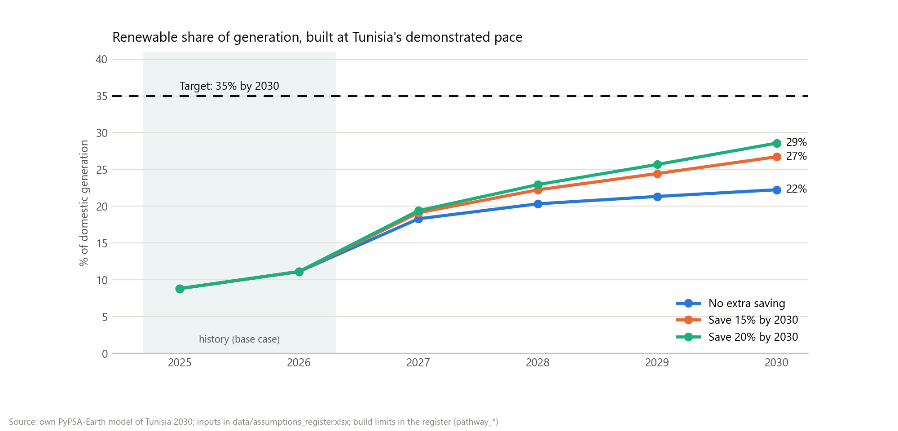
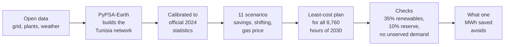

# What is one saved MWh worth to Tunisia?

### Energy efficiency and demand flexibility in Tunisia's 2030 power system, modelled hour by hour with PyPSA-Earth

[](LICENSE) [](LICENSE-docs.md)  

*By Rayen Romdhani, energy engineering student at ENIM (Monastir, Tunisia).*

---

In 2024, **94.5%** of the electricity generated in Tunisia came from burning natural gas, and about three quarters of the country's gas came from Algeria. The country has promised **35% renewable electricity by 2030**, while demand is forecast to grow 3.2% a year.

Everyone talks about building more solar. I wanted to know what happens on the other side of the meter:

> **If Tunisia uses one MWh less in 2030, what does its power system no longer have to buy, burn or build?**

So I built a model of the whole Tunisian power system, ran 2030 eleven different ways, and measured the difference. Then, because no country builds its 2030 power system in one go, I ran the four years from 2027 to 2030 one after the other, building no faster than Tunisia has managed so far.


## Four things the model found

**1. A 10% saving cancels a gas plant.** To keep a safe margin above the 2030 peak, the base case needs **423 MW of new gas turbines**. Save 10% in every hour and the model builds none of them.

**2. Timing changes what a saved MWh is worth.** Take the same 15% of energy out of summer air conditioning first, and each saved MWh avoids **20% more gas and CO2** than an even cut.

**3. Moving demand by three hours has real value.** Let 300 MW of demand shift a few hours into the midday sun, and the system saves another **22 M EUR a year** and **0.24 Mt of CO2**, on top of the 15% saving. (That is a gross value: shifting is free in the model, so the cost of making it happen is not counted.)

**4. The gas price decides what a saved MWh replaces.** With cheap gas, a saved MWh mostly displaces gas (**0.28 t of CO2** avoided). With expensive gas, the system is already 70% renewable, so it mostly displaces solar, wind and batteries (**0.11 t**, but more money).

And a plot twist: with 2030 cost projections, the cheapest 2030 system reaches **56% renewables** without being forced to. The 35% target binds only in the half-price gas case.

## At the pace Tunisia actually builds

The findings above come from 2030 on its own, where the model may build whatever is cheapest: about 6 GW of new solar and wind in one step. The pathway runs 2027, 2028, 2029 and 2030 in sequence instead. Each year keeps what was built before, the committed projects switch on in the year they are due, and new building is capped at Tunisia's demonstrated pace: **268 MW of solar a year** (its best year so far, 2024), **no new wind before 2029**, then 75 MW a year, and **batteries only from 2029** (the 150 MW Bazma tender). Every limit is a [register](data/assumptions_register.md) row with the facts behind it.



- **The 35% target is out of reach.** Renewables reach **22%** of generation in 2030. Saving 15% lifts that to **27%**, saving 20% to **29%**: the same panels cover a larger part of a smaller demand.
- **A saved MWh is mostly a gas MWh.** Over 2027-2030, each MWh saved avoids **70 EUR**, **1.95 MWh of gas** and **0.39 t of CO2**. With little room to build solar, almost every saved MWh comes off a gas plant.
- **Any saving still cancels the new gas plant.** Without extra saving the model adds 423 MW of combined-cycle capacity by 2030 to keep its reserve margin; every saving scenario adds none.
- **Shifting and the gas price matter less.** With little midday solar to move demand into, 300 MW of shifting is worth 6.9 M EUR in 2030. And at every gas price a saved MWh displaces gas: the price changes how much money it saves, not what it replaces.

The full pathway write-up, with every year's numbers, is in [Phase 6](docs/project-history/phase6-pathway.md).

## What this study is not

- **Not a forecast.** The 2030 runs show the least-cost system with no limit on how fast Tunisia can build; the pathway adds limits, but they are judgements based on its past pace, and they assume committed projects arrive on time.
- **Not a cost-benefit analysis of programmes.** Saving and shifting are free in the model: the results are what they are worth to the power system, before the cost of achieving them.
- **Not the whole grid.** Imports are fixed at 2024 levels, there are 2 nodes, and the model's daily peak comes about two hours later than the real one.

All the limits, and which way each one pushes the results, are in [chapter 6](docs/learn/06-how-far-to-trust-it.md).

## How it works, in one picture



The model plays power planner: for each scenario it decides what to build (solar, wind, batteries, gas turbines) and how to run every plant in every hour of 2030 so that the total cost is as low as possible, while meeting demand everywhere, at all times, with at least 35% renewables and a 10% reserve margin. Comparing two scenarios that differ only in demand tells you what the saving was worth.

Before using it for 2030, I calibrated it to reproduce 2024: the official gas fleet, the official peak, and the gas Tunisia's power plants actually burnt (within 0.4%).

## Learn the topic, step by step

New to power systems? The learning path explains everything from scratch, one short chapter at a time:

| | Chapter | You will learn |
|---|---|---|
| 1 | [The problem](docs/learn/01-the-problem.md) | How Tunisia makes its electricity, where its gas comes from, the 2030 promise |
| 2 | [Key ideas](docs/learn/02-key-ideas.md) | Energy vs power, the merit order, reserve margins, efficiency vs flexibility |
| 3 | [How the model works](docs/learn/03-how-the-model-works.md) | Least-cost planning as a game with rules; PyPSA-Earth; where each piece of code fits |
| 4 | [The experiment](docs/learn/04-the-experiment.md) | The 11 scenarios in plain words, and the 2027-2030 pathway |
| 5 | [Results](docs/learn/05-results.md) | Every figure, what to look at, what it means |
| 6 | [How far to trust it](docs/learn/06-how-far-to-trust-it.md) | The 2024 check and what the model cannot see |
| 7 | [Try it yourself](docs/learn/07-try-it-yourself.md) | Run the model, add your own scenario |
| | [Glossary](docs/learn/glossary.md) | Every term in one or two lines |

Prefer a document? There is a [written report](report/report.docx) and a [9-slide deck](report/deck.pptx). Prefer to explore? The [interactive site](site/) tells the study through one summer day: scroll moves the clock across a 3D landscape whose sun, solar field, turbines and gas plant follow the model's real hourly output, then on to the answer, a "choose how Tunisia saves" panel, the four years to 2030 and the limits (see [`site/README.md`](site/README.md) to run it locally).

## Where the numbers come from

No number in this study is made up. Every input is a row in the [assumptions register](data/assumptions_register.md), with its source and link: ONEM's 2024 energy statistics, STEG's forecasts (via JICA, 2022), and 2030 technology costs from PyPSA technology-data. A value with no published source is labelled `assumption` and explained.

## What is in the repository

| Folder | What is inside |
|---|---|
| [`docs/learn/`](docs/learn/) | The learning path (start here) |
| [`results/`](results/) | Result tables and figures |
| [`data/`](data/) | The assumptions register and committed projects |
| [`config/`](config/) | One small file per scenario, and the PyPSA-Earth settings |
| [`src/tn2030/`](src/tn2030/) | The study's Python package |
| [`scripts/`](scripts/) | Figures, report, slides, register export, 2024 validation (`scripts/dev/` holds one-off helpers) |
| [`tests/`](tests/) | Automated tests |
| [`report/`](report/) | Report and slides |
| [`site/`](site/) | The interactive web page (a scroll story with 3D scenes), fed by `scripts/export_site_data.py` |
| [`skill/`](skill/) | `pypsa-country-study`: the method and its pitfalls, packaged for a study of another country |
| [`docs/project-history/`](docs/project-history/) | The lab notebook: how the study was built, phase by phase |

## Run it yourself

You need Windows (the environment file pins Windows builds), [Miniforge](https://github.com/conda-forge/miniforge), and about 45 GB of free disk (PyPSA-Earth's data takes 41 GB once unpacked). [Chapter 7](docs/learn/07-try-it-yourself.md) has the full walkthrough; the short version. Clone PyPSA-Earth and this repository side by side:

```bash
git clone --branch v0.10.0 https://github.com/pypsa-meets-earth/pypsa-earth.git
```
```bash
git clone https://github.com/RayenRomdhani/TEP30-35.git
```
Then, inside this repository's folder:
```bash
conda env create -f environment.yml
```
```bash
conda activate pypsa-earth
```
```bash
pip install -e .
```
```bash
snakemake -j 1 networks/TN/elec_s_2_ec_lcopt_1h.nc --configfile <path-to-this-repo>/config/tn_base.yaml
```
(run that one in the PyPSA-Earth folder; about 6 hours the first time, mostly downloads; then set `base_network` in `config/pipeline.yaml`). Back in this repository:
```bash
pytest
```
```bash
snakemake -j 1
```
```bash
python scripts/make_figures.py
```

The 112 tests cover 98% of the study's code (`pytest --cov=tn2030 --cov-branch`); those that need the real Tunisia network skip themselves if it is missing.

## Licence and citation

Code under the [MIT licence](LICENSE); text, figures, report and slides under [CC BY 4.0](LICENSE-docs.md). To cite this work, use [`CITATION.cff`](CITATION.cff) (GitHub shows a "Cite this repository" button).
