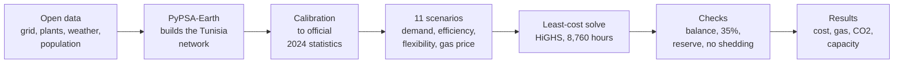

# 3. How the model works: the cheapest power system that keeps the lights on

> **Learning path:** [1. The problem](01-the-problem.md) · [2. Key ideas](02-key-ideas.md) · **3. How the model works** · [4. The experiment](04-the-experiment.md) · [5. Results](05-results.md) · [6. How far to trust it](06-how-far-to-trust-it.md) · [7. Try it yourself](07-try-it-yourself.md) · [Glossary](glossary.md)

## The game

Imagine you are Tunisia's power planner for 2030. You get:

- a map with the existing grid and power plants,
- the electricity demand for **every one of the 8,760 hours** of the year,
- how much sun and wind there is in each of those hours,
- a price list: what each kind of plant costs to build and to run.

Your job: decide **what to build** (how many MW of new solar, wind, batteries and gas turbines) and **how to run everything, hour by hour**, so that the total yearly cost is as low as possible.

The rules you cannot break:

1. In every hour, at every node of the grid, supply equals demand.
2. No plant produces more than its size, and solar and wind no more than the weather allows.
3. At least **35%** of the year's domestic generation is renewable.
4. Firm capacity is at least **10%** above the peak (the reserve margin).
5. Plants that exist or are already under construction must be kept.

That is a **linear program**: one cost to minimise, about half a million rules, all of them straight-line relationships. A solver (here the open-source **HiGHS**) finds the best answer in a few minutes. Nobody tells the model "build solar"; it builds solar because, with these costs and rules, that is the cheapest way through the year.

## The tools

- **[PyPSA](https://pypsa.org)** ("Python for Power System Analysis") is an open-source library for this kind of model: you describe buses, lines, generators and storage, and it writes the linear program.
- **[PyPSA-Earth](https://github.com/pypsa-meets-earth/pypsa-earth)** builds a ready-made PyPSA network for almost any country from open data: OpenStreetMap for the grid, global plant databases, ERA5 weather data (year 2013 here) for solar and wind, and a demand profile. This study uses release v0.10.0, unchanged.
- **This repository** adds what a real study needs on top: calibration to official statistics, the scenarios, the extra rules (35% target, reserve margin, demand shifting), checks after every solve, and the results.

## The Tunisia network in the model

- **2 nodes:** north (around 36.5° N) and south (around 34.4° N), joined by one 292 km line.
- **8,760 hourly steps** (one weather year).
- **Existing plants** as in the official 2024 statistics: 2,527 MW of combined cycles and 3,117 MW of gas turbines and steam units, plus existing solar, wind and hydro.
- **Committed projects** (under construction or contracted): about 1.1 GW of solar and 18.5 MW of wind, listed with sources in [`data/committed_projects.csv`](../../data/committed_projects.csv).
- **What the model may add:** solar, onshore wind, batteries and new gas turbines, at 2030 costs.

## Before trusting it: calibration

PyPSA-Earth's open data got the 2024 gas fleet wrong (it saw everything as combined cycles, plus 1,409 MW of oil plants that the official statistics do not list) and its demand curve was too flat. So the study first rebuilt the 2024 system from official numbers and checked it: the calibrated model burns the same gas as STEG did in 2024 within 0.4%, and hits the 2024 peak within 0.3%. [Chapter 6](06-how-far-to-trust-it.md) has the full check.

## Where each piece lives in the code

| Step | Code |
|---|---|
| Read the input numbers | [`src/tn2030/register.py`](../../src/tn2030/register.py) |
| Fix the gas fleet, add new gas turbine options | [`src/tn2030/fleet.py`](../../src/tn2030/fleet.py) |
| 2030 demand and its shape | [`src/tn2030/demand.py`](../../src/tn2030/demand.py) |
| Efficiency cuts | [`src/tn2030/efficiency.py`](../../src/tn2030/efficiency.py) |
| Demand shifting | [`src/tn2030/flexibility.py`](../../src/tn2030/flexibility.py) |
| 35% target, reserve margin, solve | [`src/tn2030/constraints.py`](../../src/tn2030/constraints.py) |
| Build one scenario | [`src/tn2030/scenario.py`](../../src/tn2030/scenario.py) |
| Checks after the solve | [`src/tn2030/checks.py`](../../src/tn2030/checks.py) |
| Results and "avoided per MWh" | [`src/tn2030/results.py`](../../src/tn2030/results.py) |
| The whole chain | [`Snakefile`](../../Snakefile), [`src/tn2030/pipeline.py`](../../src/tn2030/pipeline.py) |

---

**Next:** [4. The experiment](04-the-experiment.md): the 11 versions of 2030 the model was asked to plan.
