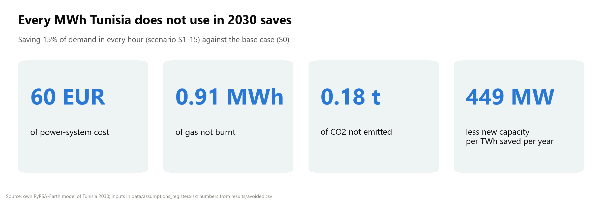
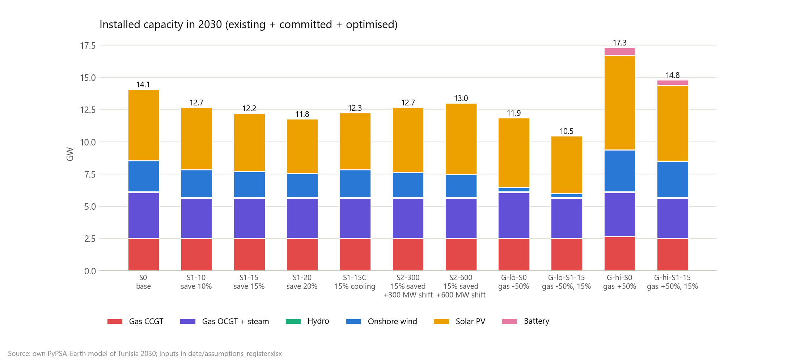
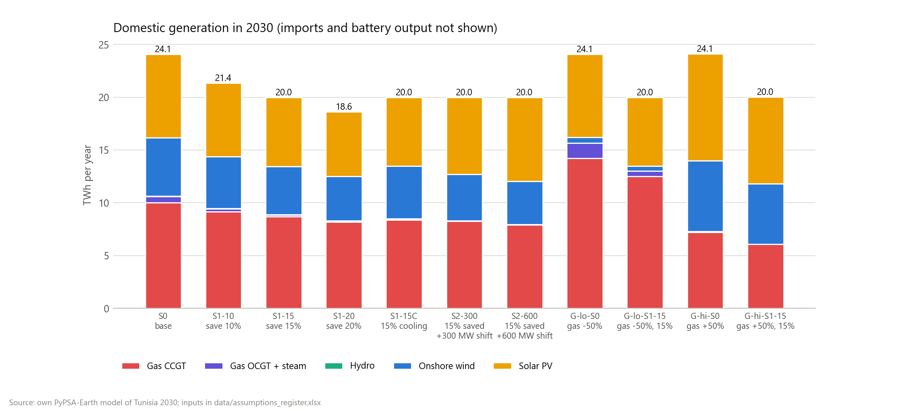
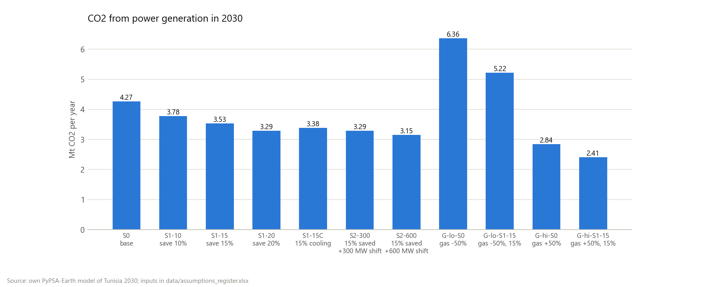
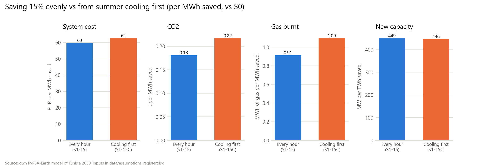
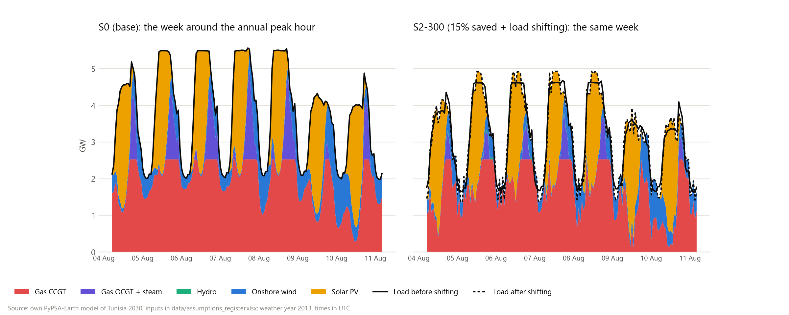
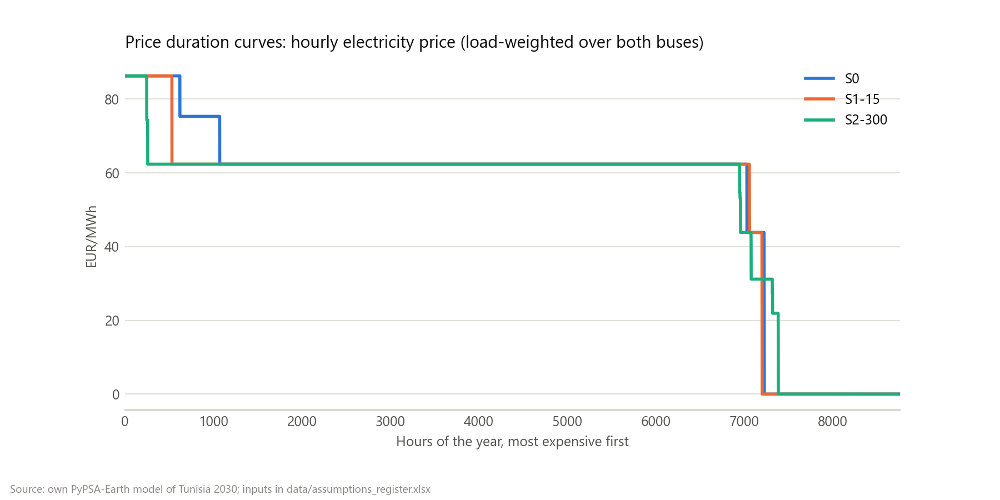
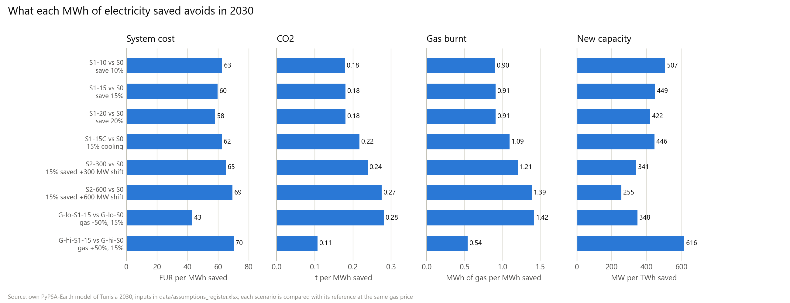
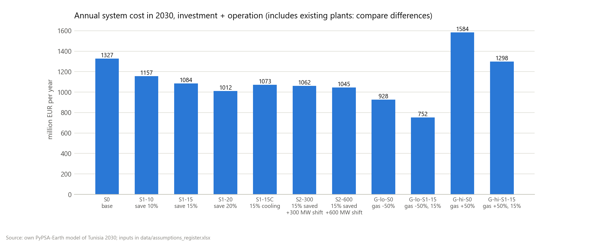

# 5. Results: what one MWh saved is worth

> **Learning path:** [1. The problem](01-the-problem.md) · [2. Key ideas](02-key-ideas.md) · [3. How the model works](03-how-the-model-works.md) · [4. The experiment](04-the-experiment.md) · **5. Results** · [6. How far to trust it](06-how-far-to-trust-it.md) · [7. Try it yourself](07-try-it-yourself.md) · [Glossary](glossary.md)

Every number on this page comes from [`results/summary.csv`](../../results/summary.csv) and [`results/avoided.csv`](../../results/avoided.csv), written by the pipeline. The figures are drawn from the same files.

## The headline

Saving 15% of demand in every hour (S1-15 against S0) avoids, **per MWh saved**: about **60 EUR** of system cost, **0.91 MWh** of gas, **0.18 t** of CO2, and **449 MW** of new plants (mostly solar and wind) per TWh saved each year.

Where does the 60 EUR come from? Roughly, the average price of electricity in the base case (54.7 EUR/MWh), plus the gas turbines the saving makes unnecessary.

## Finding 1: a 10% saving cancels the new gas plant

To keep a 10% reserve above the 2030 peak, the base case has to build **423 MW of new gas turbines**. Save 10% in every hour and the peak drops enough that the model builds **none**. That is why the first 10% saved is worth the most (62.6 EUR/MWh on average, against 59.6 for 15% and 58.0 for 20%): it carries all of the avoided gas capacity. Look at the *extra* savings instead: going from 10% to 15% is worth about 53.7 EUR per extra MWh, and from 15% to 20% about 53.0, close to the average electricity price. Once the gas turbines are gone, a saved MWh is worth roughly what electricity costs.

## Finding 2: a saved MWh cuts gas *and* renewables

Of the electricity no longer needed in S1-15, **43% would have come from gas and 57% from renewables** that the model now does not build. Saving electricity does not only cut fossil fuel: in a least-cost system with cheap solar, part of the saving replaces solar panels that no longer need to be built.

The gas and CO2 bars tell the same story in absolute terms:

## Finding 3: timing changes what a saved MWh is worth

S1-15C saves exactly as much energy as S1-15, but takes it first from summer air conditioning. Only 39% of the saving fits there, and still each MWh saved avoids **20% more gas and CO2**, and the system costs **11.5 M EUR a year less** than with an even cut: saving in those hours displaces more gas than saving in an average hour.

Size still matters more in total: saving 20% evenly (S1-20) burns less gas than saving 15% cooling-first (16.6 against 17.1 TWh). Timing is about making each MWh count. (One caution: the model's daily peak comes about two hours later than the real one, which affects this result; see [chapter 6](06-how-far-to-trust-it.md).)

## Finding 4: moving demand by three hours is worth a lot

Look at the right-hand panel: the dashed line (load after shifting) climbs into the yellow solar hours and dips in the evening. With 300 MW of shiftable load on top of the 15% saving (S2-300):

- the model moves morning (05:00-08:00 UTC) and evening (16:00-20:00 UTC) load into midday (09:00-14:00 UTC), about 1.07 TWh a year;
- it builds about 525 MW more solar and 85 MW less wind, and burns less gas;
- the system costs **22.1 M EUR a year less** than S1-15 and emits **0.24 Mt less CO2**. That is about **74,000 EUR per MW of shifting per year**. With 600 MW the gain is 39.2 M EUR, about 65,000 EUR per MW: still large, a bit less per MW.

These are **gross values**: shifting is free in the model, so whatever it costs to make demand flexible (smart controls, tariffs, programmes) has to come out of them.

The price curves show where the value comes from. Sorted from the most expensive hour to the cheapest, prices sit on two plateaus, about 86 EUR (existing gas turbines at the margin) and about 62 EUR (existing combined cycles), and the cheapest hours (solar surplus) are free. With shifting, fewer hours sit at the top price, and some of the free solar-surplus hours get used:

## Finding 5: the gas price flips the story

| | Cheap gas (×0.5) | Base | Expensive gas (×1.5) |
|---|---|---|---|
| Avoided cost per MWh saved | 43 EUR | 60 EUR | 70 EUR |
| Avoided CO2 per MWh saved | 0.28 t | 0.18 t | 0.11 t |
| Renewable share in the base case | 35% (the target binds) | 56% | 70% |

With cheap gas, the system burns lots of it and only just meets the 35% target, so each MWh saved mostly displaces gas: big CO2 savings. With expensive gas, the system is already 70% renewable with 628 MW / 3,148 MWh of batteries, so a saved MWh mostly avoids solar, wind and batteries: smaller CO2 savings, but more money.

## A surprise worth flagging

At the base gas price, the cheapest 2030 system reaches **56% renewables on its own**, far above the 35% target. With 2030 costs, new solar and wind are simply cheaper than running the existing gas fleet. But the model has no limit on how fast Tunisia can build them, so read this as "what least cost would do", not "what will happen". [Chapter 6](06-how-far-to-trust-it.md) explains why.

## All the numbers

| | S0 | S1-10 | S1-15 | S1-20 | S1-15C | S2-300 | S2-600 |
|---|---|---|---|---|---|---|---|
| Domestic demand (TWh) | 24.08 | 21.36 | 20.00 | 18.64 | 20.00 | 20.00 | 20.00 |
| New gas turbines (MW) | 423 | 0 | 0 | 0 | 0 | 0 | 0 |
| New solar (MW) | 3,929 | 3,237 | 2,928 | 2,606 | 2,802 | 3,453 | 3,948 |
| New onshore wind (MW) | 2,121 | 1,857 | 1,714 | 1,574 | 1,853 | 1,629 | 1,485 |
| Gas burnt (TWh, thermal) | 21.55 | 19.09 | 17.83 | 16.60 | 17.09 | 16.63 | 15.89 |
| CO2 (Mt) | 4.27 | 3.78 | 3.53 | 3.29 | 3.38 | 3.29 | 3.15 |
| Renewable share | 56% | 56% | 56% | 56% | 57% | 58% | 60% |
| System cost (M EUR/yr) | 1,327 | 1,157 | 1,084 | 1,012 | 1,073 | 1,062 | 1,045 |
| Average price (EUR/MWh) | 54.7 | 54.2 | 53.5 | 52.8 | 53.1 | 52.5 | 51.9 |

(The system cost includes plants that already exist, so compare differences between scenarios, not the absolute level.)

---

**Next:** [6. How far to trust it](06-how-far-to-trust-it.md): what was checked, and what the model cannot see.
