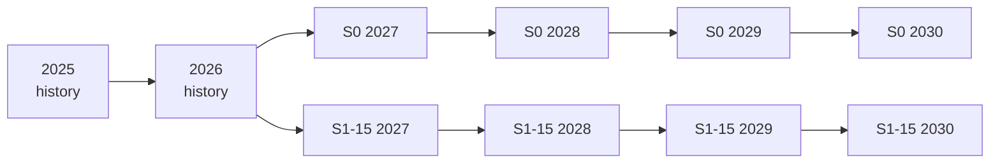
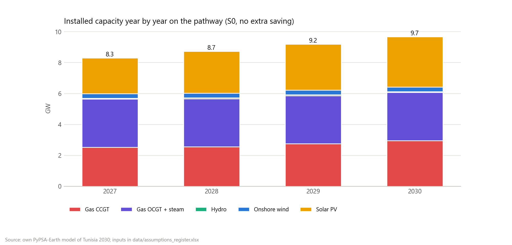
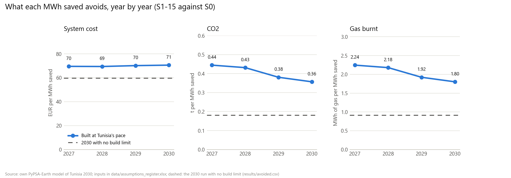

# Phase 6: the 2027-2030 pathway

**Question:** the 2030 runs of Phase 4 let the model build whatever is cheapest in one step: about 6 GW of new solar and wind on top of a fleet that had 0.8 GW of solar at the end of 2024. Tunisia does not build that fast. What changes if the model has to get to 2030 one year at a time, at the pace Tunisia has actually shown?

Design: [specs/2026-10-29-pathway-2027-2030-design.md](specs/2026-10-29-pathway-2027-2030-design.md). Code: [`src/tn2030/pathway.py`](../../src/tn2030/pathway.py), the `pathway_year` and `pathway_summarize` rules in the [`Snakefile`](../../Snakefile), tests in [`tests/test_pathway.py`](../../tests/test_pathway.py).

## How the years are chained

(Two of the eleven scenarios shown; all eleven branch the same way.)

- **2025 and 2026** are solved once, in the base case, to bring the fleet from 2024 to the start of the plan. Every scenario then branches off from the end of 2026.
- **Each year starts from the year before.** Everything the previous year built becomes this year's floor (`carry_over`): plants are never taken down.
- **Committed projects switch on in their year** (`cod_expected` in [`data/committed_projects.csv`](../../data/committed_projects.csv)). Segdoud has no date and is left to the yearly allowance.
- **Myopic, not perfect foresight.** Each year is a least-cost solve for that year alone. That is closer to how Tunisia procures (tender by tender) than a model that sees 2030 from 2027.
- **Demand** grows 3.2% a year from 2024; imports stay at their 2024 level.

## How fast Tunisia can build: the limits

Every limit is a row of the [assumptions register](../../data/assumptions_register.md), typed `assumption` because each one is a judgement built on sourced facts.

| Limit | Value | Why |
|---|---|---|
| New solar beyond the committed projects | 268 MW a year | Solar reached 773 MW at the end of 2024, 53% more than a year before (Enerdata, 4 Feb 2026): 268 MW added in Tunisia's fastest year so far |
| New wind | none before 2029, then 75 MW a year | No large wind farm since Sidi Daoud; 2 GW of wind tenders were cleared in January 2026 with wind measurements still pending; award to operation takes about two years; 75 MW is one lot of the 2023 tender (Enerdata, 5 Jan 2023) |
| Batteries | none before 2029, then up to 150 MW / 540 MWh | The Bazma solar-plus-storage tender, bids due October 2026 (Mercom, Mar 2026) |
| New gas turbines | no limit | A gas turbine can be added within a year, and the 10% reserve margin needs them |
| The 35% renewable target | reported, not enforced | At this pace it cannot be reached; forcing it would make the model infeasible or make it build faster than Tunisia can |

The allowance of each year is split between the two nodes in proportion to the capacity each already has of that technology.

**Savings and shifting ramp up.** A scenario's saving is reached a quarter at a time: ¼ in 2027, ½ in 2028, ¾ in 2029, all of it in 2030. ANME's own goal is a 30% cut in demand by 2030 (AllAfrica, 24 Oct 2025), so 10-20% by 2030 is within the official ambition. Gas-price scenarios apply their price from 2027.

## Results

All 46 solves (2 history years and 11 scenarios × 4 years) finished in about a minute each. Numbers below are from [`results/pathway_summary.csv`](../../results/pathway_summary.csv) and [`results/pathway_avoided.csv`](../../results/pathway_avoided.csv).

### 1. The 35% target is out of reach at this pace

| Year | 2025 | 2026 | 2027 | 2028 | 2029 | 2030 |
|---|---|---|---|---|---|---|
| Renewable share, no extra saving (S0) | 8.8% | 11.1% | 18.3% | 20.3% | 21.3% | **22.2%** |
| Saving 15% by 2030 (S1-15) | | | 19.1% | 22.2% | 24.4% | **26.7%** |
| Saving 20% by 2030 (S1-20) | | | 19.4% | 22.9% | 25.7% | **28.6%** |

- **Where it starts:** 2025 is the calibrated 2024 fleet plus Kairouan (100 MW) and one year of the solar allowance. The 2027 jump comes from the 0.8 GW of committed projects due that year; if they slip, the whole line moves right.
- **The solar limit binds in every year and every scenario** except cheap gas: the model always wants more solar than Tunisia can build. At the base gas price it adds no new wind and no batteries even when allowed (2029-2030); with gas 50% dearer it takes the full 75 MW of wind a year.
- **Saving closes about a third of the gap.** The same panels cover a larger part of a smaller demand: 15% saved lifts 2030 from 22% to 27%, 20% saved to 29%. No scenario reaches 35%.

### 2. A saved MWh is mostly a gas MWh

Saving 15% by 2030 (S1-15) against S0:

| | 2027 | 2028 | 2029 | 2030 | All four years |
|---|---|---|---|---|---|
| Cost avoided (EUR per MWh saved) | 69.5 | 69.4 | 70.1 | 70.5 | **70.1** |
| Gas avoided (MWh per MWh saved) | 2.25 | 2.18 | 1.92 | 1.80 | **1.95** |
| CO2 avoided (t per MWh saved) | 0.44 | 0.43 | 0.38 | 0.36 | **0.39** |

"All four years" divides the avoided totals by the total MWh saved. Over 2027-2030 the 15% path saves 9.9 TWh, 693 M EUR, 19.3 TWh of gas and 3.8 Mt of CO2.

In 2027 a saved MWh avoids 2.25 MWh of gas: almost all of it comes off a gas plant (at about 44% efficiency). As more solar arrives, a growing part of each saved MWh would have come from solar, so the gas and CO2 per MWh fall. They stay about twice as high as in the 2030 run with no build limit (the dashed lines), where a saved MWh mostly cancels solar and wind that would otherwise be built.

### 3. Any saving cancels the new gas plant

Without extra saving, the reserve margin makes the model add **423 MW of combined-cycle capacity** in 2028-2030 (26, 196 and 202 MW). Every saving scenario, from 10% up, adds none. The size matches the 423 MW of gas turbines in the unconstrained 2030 run, because both are set by the same rule (firm capacity 10% above the peak); the type differs because here gas runs many more hours, so the more efficient plant pays.

### 4. Shifting is worth less when solar is scarce

300 MW of shifting on top of the 15% saving is worth **6.9 M EUR** and **0.05 Mt of CO2** in 2030 (S2-300 against S1-15). That is much less than in the unconstrained run, because there is far less midday solar surplus to move demand into. Cooling-first savings (S1-15C) avoid only about 1% more gas per MWh than an even cut, for the same reason.

### 5. The gas price no longer flips the story

| Gas price | Cost avoided | CO2 avoided |
|---|---|---|
| Half price (G-lo-S1-15 vs G-lo-S0) | 40.9 EUR/MWh | 0.43 t/MWh |
| As forecast (S1-15 vs S0) | 70.1 EUR/MWh | 0.39 t/MWh |
| 50% dearer (G-hi-S1-15 vs G-hi-S0) | 95.2 EUR/MWh | 0.36 t/MWh |

(All four years.) In the unconstrained run, expensive gas made the model build so much solar and wind that a saved MWh mostly displaced renewables. With building limited, a saved MWh displaces gas at every gas price: the price sets how much money it saves, not what it replaces. With cheap gas the model builds less than the solar allowance (191-212 MW a year), the only case where the limit does not bind.

### Checks

Every solve passed the energy balance, the committed-plant and the reserve-margin checks. The only warnings are on the peak: in the saving scenarios the peak falls more than 10% below STEG's forecast, scaled to the year's demand, because the forecast does not know about the saving (S1-15C warns from 2027, because it removes the summer cooling bump first). The same warning appears in the Phase 4 runs, for the same reason.

### Effect on the Phase 4 runs

Adding Voltalia's 132 MW at Gabès to the committed projects re-ran the eleven 2030 scenarios. Every result is unchanged except that 132 MW of the solar the model was already building now counts as committed, not new: "new solar" in each scenario is 132 MW lower than in the Phase 4 table (S0: 3,797 MW instead of 3,929). Total capacity, cost, gas, CO2 and every avoided-per-MWh value are the same.

## What changes in the conclusions

- The **direction** of every Phase 4 finding holds: saving avoids cost, gas, CO2 and the new gas plant.
- The **size** changes where the build limit matters. At Tunisia's pace a saved MWh is worth about 70 EUR, not 60, and it avoids roughly twice the gas and CO2. This is the effect the Phase 4 limits section predicted ("with a build limit, more gas runs").
- The **flexibility and gas-price stories** were partly a product of unlimited building: shifting is worth much less, and the gas price no longer changes what a saved MWh displaces.
- The **35% target** is out of reach by 2030 at the pace Tunisia has shown; efficiency is the cheapest way to close part of the gap.

## Limits of the pathway

- **The limits are judgements.** 268 MW a year is the best year so far; a faster year (for example if the 2 GW of wind tenders move quickly) would raise every share. The limits are register rows, so another set is one edit away.
- **Myopic.** Each year is planned without knowing the next; a planner with foresight might build gas plants a little differently.
- **Same weather year (2013) every year**, and the same technology costs as the 2030 runs.
- **Committed projects are assumed on time.** A delay moves the whole line to the right.
